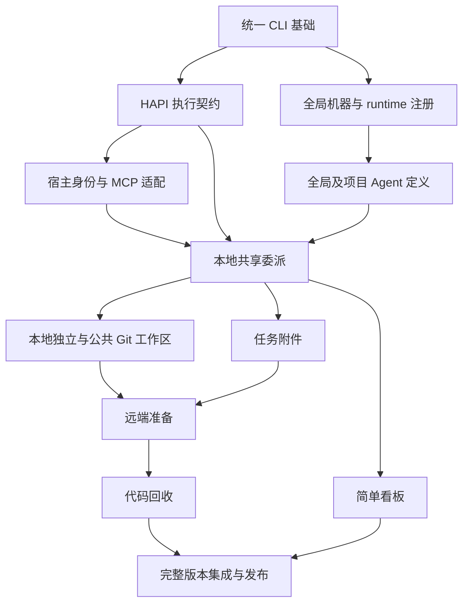
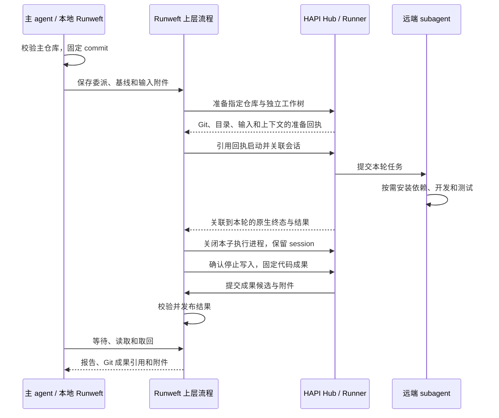

# 项目能力边界与讨论地图

> 更新：2026-09-29
> 本文组织目标、Change 依赖和讨论顺序，不是已实现 Specs，也不表示各 Change 的需求或技术方案已经整体确认。

## 产品边界

只接入 Codex 与 Claude Code 主宿主，协作体验尽量对齐原生 Codex；执行目标与主客户端独立。Runweft 提供 MCP 和 HAPI 上层流程封装，何时使用什么 agent 由业务 skill 与主 agent 决定，不构建自动业务编排器。

执行侧直接复用 HAPI 已内置的 Codex/Claude Code 适配，不预设新增或主动改造其 launcher、原生协议、会话、审批与恢复。下文“执行契约”指已有能力的验证与调用封装；只有可复现缺口阻断既定行为时才评估最小增补。后续私有 runtime 接入不作为本轮交付前置。

**HAPI 已有能力优先复用。** 技术方案按“当前入口 → 是否足够 → 最小缺口”推导；已有会话、消息、状态、恢复、审批、文件与 UI 不重复实现。旧工程只参考交互和历史证据，不能完全照搬其 daemon、状态机、认证锁或补丁；具体边界见[执行基础需求](archive/2026-09-29-hapi-subagent-foundation/requirement.md#已确认的架构决策)。

协作服务的运行位置已在[统一 CLI 技术方案](archive/2026-09-29-unified-cli-and-deployment/technical.md#服务与数据归属)中落实：Runweft 服务与原有 HAPI Hub 同机部署，共用 HTTP 入口和 HAPI 认证；本地模式部署在本机，Hub 模式部署在所选中心。只补父子关联、角色分流、工作区准备与成果交付，不复制 HAPI 原生会话库。基础安装与部署已通过四个平台验收并归档，当前行为见[部署 Spec](specs/deployment/spec.md)；业务关联与协作仍由后续 Change 实现。

## 完整版本的交付目标

2026-09-29 用户明确要求后续持续推进，交付完整、可安装运行的重构版本，不以 MVP、演示骨架或只有部分链路的版本结项。原十个领域 Change 的产品范围保留，另设全局资源注册和完整版本集成与发布两个 Change，共十二个；分阶段只用于控制依赖与验证，不降低最终交付范围。

完整交付须覆盖统一 CLI 一键辅助全局安装 MCP、清晰配置与持久数据布局、本地/Hub 两种运行模式、全局机器/runtime 注册、Codex/Claude Code 宿主 MCP、本地共享与独立工作区、远端准备与执行、等待/中断/续接、附件与代码取回、Agent 定义及全局 subagent 看板，并提供部署、诊断与维护说明。主 agent 负责代码接纳和冲突；产品自身不增加合并执行器。

复用 HAPI 的详情、审批、机器管理及默认权限属于完整方案，不要求重写。简单全局看板就是本轮目标；正式工作台、集中 skill/MCP 管理、主宿主退出后的恢复和 runtime 插件平台继续不在范围内。

验收必须同时具有原生交互和安装部署证据：覆盖两种宿主、两种内置 runtime、本地/远端工作模式、任务续接、失败与交付重试，以及 macOS 正式安装。本地验收由 agent 自动完成，不要求用户亲自测试或逐项批准；真实远端协作需要机器/访问条件时才请用户参与。源码、模拟测试、单机多进程或 Git 原语实验不能独自替代这些证据。真实运行所需的专用环境与授权需落实，未验证项不能通过减少声明来冒充完整交付。

## 当前 Changes

拆分审查、六个阶段的验收出口和唯一职责见 [Change 边界与分阶段交付](delivery-structure.md)。本次调整复用已有目录；下表为调整后的依赖，不再让本地执行依赖远端准备，或让宿主身份反向依赖委派。

| Change | 独立交付结果 | 前置 Change |
| --- | --- | --- |
| [统一 CLI 与部署（已完成）](archive/2026-09-29-unified-cli-and-deployment/requirement.md) | 可安装的基础入口、公共配置/数据位置、HAPI 管理与诊断 | 无；固定现有 HAPI 构建 |
| [HAPI 内置能力验证与调用封装（已完成）](archive/2026-09-29-hapi-subagent-foundation/requirement.md) | 验证并封装已有启动、输入、原生结果、停止与续接入口 | 统一 CLI |
| [宿主适配（已完成）](archive/2026-09-29-host-mcp-adapter/requirement.md) | 两宿主可信身份、受控子执行的 MCP 禁用与结果传递机制 | 统一 CLI、HAPI 执行契约 |
| [全局资源注册](changes/execution-resource-registry/requirement.md) | 分别注册机器和 runtime，查询真实可用性 | 统一 CLI |
| [Agent 定义](changes/agent-definition/requirement.md) | 可发现、校验及解析的全局/项目定义，引用 runtime | 统一 CLI、全局资源注册 |
| [委派生命周期](changes/delegation-lifecycle/requirement.md) | CLI/MCP 本地共享目录的完整协作与统一查询 | 统一 CLI、HAPI 执行契约、宿主适配、Agent 定义、全局资源注册 |
| [本地工作区执行](changes/local-workspace-execution/requirement.md) | 独立本地协作及公共 Git 准备/封存/保留能力 | HAPI 执行契约、委派生命周期 |
| [任务附件交付](changes/task-artifact-delivery/requirement.md) | 独立文件交付及既有任务的输入/输出接入 | 统一 CLI、委派生命周期 |
| [远端工作区准备](changes/remote-workspace-preparation/requirement.md) | 跨机基线与输入落地，复用公共工作区启动校验 | HAPI 执行契约、本地工作区、任务附件 |
| [远端代码回收](changes/remote-result-delivery/requirement.md) | 真实远端协作至主仓库取得成果的完整链路 | 远端准备、本地工作区、委派生命周期、任务附件 |
| [Subagent 看板](changes/subagent-dashboard/requirement.md) | 基于统一查询的全局概览，详情复用 HAPI | 委派生命周期、统一 CLI |
| [集成与发布](changes/integrated-release/requirement.md) | 全部能力组成同一可安装版本及完整实测证据 | 以上十一个领域 Change |

图省略传递依赖，完整直接前置以表格及各 Requirement 为准。前置表示实现与验收所需能力，不限制只读调查。统一 CLI 与 HAPI 执行契约已验收归档，其余 Change 待逐项细化，既有确认继续有效；design.md 和阶段说明不代替正式 Technical/Plan。

## 本轮已经收敛的范围

- 本地模式无需用户另部署共享 Hub；Hub 模式连接明确目标，二者复用 HAPI 基础与同一业务契约。持久数据有受控根及路径诊断，不依赖随机临时目录。
- 机器注册、runtime 注册和 agent 定义分离：前两者全局，agent 可全局或项目级。引用方向是 agent → runtime → machine；HAPI 的 agent flavor 不直接等于业务 agent 定义。
- CLI 提供显式命令一键辅助全局安装、更新、诊断及卸载 Runweft MCP；开发验证使用专用配置，保留用户其他 MCP 与原生设置。

- 主宿主关闭后不要求恢复；在线主会话的查看、等待和续接按宿主适配实现。
- 远端只用独立 worktree；本地共享或独立由主 agent 决定。工作区分离不等于额外权限隔离。
- Agent 定义参考 Multica 的职责、指令与 runtime 分工；不集中管理 skill/MCP。启动 cwd 是主工作目录或准备完成的 worktree，沿原生规则加载项目配置。
- 只允许一层 Runweft 委派。HAPI 调度的 Runweft subagent 移除全部 Runweft MCP 工具，结果由 HAPI 原生输出收回；CLI 委派入口也拒绝受控子执行再次派生。原生内置 subagent 的使用和递归不由 Runweft 管控。
- 每轮任务结束关闭子执行进程，保留可续接的 session 和工作区；后续优先由 HAPI resume，确认 session 缺失才构造历史上下文。
- 冲突、合入与发布交给主 agent；权限沿 HAPI/原生默认，不新增隔离或独立权限体系。先做简单全局看板，正式工作台和统一 agent 控制台留待以后。

## 远端组合流程

这是跨 Change 的目标流程，独立 worktree 内程序化 checkpoint 与默认 bundle 交付已获用户确认。准备成功、执行结束、成果可取回和验收分别有自己的证据，不能合为一个完成标志。

## 共享对象的归属

这里只标记谁定义契约，不提前固定 API schema；下游引用上游定义，不各自造一份身份。

| 对象 | 定义归属 | 稳定范围 |
| --- | --- | --- |
| 主体、namespace、`workspaceId` 与主工作区绑定入口 | 统一 CLI 与部署 | 授权主体与真实主机目录；宿主父身份的取得方式另待调查 |
| `hapiSessionId`、原生输入/轮次身份 | HAPI 执行契约 | 真实执行与恢复关联，不能假定恢复后 ID 永远不变 |
| machineId、runtimeId 与已解析执行目标 | 全局资源注册 | 当前用户/所选 Hub 的全局范围，项目定义只能引用；沿 HAPI 身份和查询映射 |
| 全局/项目 agent 标识与定义版本 | Agent 定义 | 职责和 runtime 引用，与机器及 runtime 注册分开 |
| 宿主身份、主/子角色与 MCP 传递上下文 | 宿主适配 | 在委派之前识别，不由模型自报；业务工具由委派注册 |
| `delegationId`、`roundId` | 委派生命周期 | 关联已验证主工作区的父子上下文与每次明确任务输入；不由 prompt 任意路径代替工作区绑定 |
| `repositoryId`、`environmentId`、`preparationId`、固定 Git 成果 | 本地工作区执行 | 公共 Git 生命周期；远端准备消费，不重新定义身份或收尾 |
| `artifactId`、不可变对象与引用 | 任务附件交付 | 可授权读取的输入/输出及版本 |
| `resultId` 与轮次报告关联 | 委派生命周期 | 结果归属和交付摘要；Git 成果字段由远端代码回收补充 |
| `requestId` | 各操作提供方 | 在主体与操作范围内去重；相同键不同内容拒绝，不能据此宣称跨服务原子事务 |

Runweft 只补必要协作与交付关联，原生会话/执行事实优先读取 HAPI，不复制成另一套会话库。CLI 和 MCP 复用同一上层流程，已有重试与消息去重沿 HAPI 实现。

## 下一步技术调查

| 事项 | 当前证据与下一步 |
| --- | --- |
| 宿主身份与工具禁用 | 两宿主身份、Claude clear/resume、全局安装及 HAPI 子执行启动/续接的工具禁用已实测，见[宿主验收](archive/2026-09-29-host-mcp-adapter/execution.md#t4-配套构建与宿主整体验收)；原生子 agent 不管控 |
| 子进程关闭与 session 续接 | HAPI 已有原生读取/恢复路径，先核对何处可直接使用；共享 runtime 不得因关闭一个子执行而影响其他任务 |
| 配置继承 | 核对 HAPI 是否保留原生全局/项目配置与 cwd；远端不自动拥有发起机的全局 skill/MCP，ignored 项目配置不凭空随 Git 同步 |
| 通知与结果进入上下文 | 旧 wait 工具响应可作交互参考，但不等同原生后台唤醒。在线宿主注入能力按公开入口验证，不增加主宿主退出恢复目标 |
| Git 成果方案 | 独立 worktree 自动 checkpoint 与默认 bundle 已确认；后续落实提交身份、hook/签名、对象保留及传输验证，不改动共享主目录 |

这些可调查事项继续进入对应 Research，不要求用户猜测技术事实。后续正式方案逐项列出 HAPI 复用点和确实需要新增的部分，不迁回旧实现框架。

## 实施就绪性

2026-09-29 按完整版本目标复核：产品模块与职责边界已收敛，但技术方案尚不足以将全部剩余工作视为编码细节。没有正式 Technical/Plan 只是表面状态，实质缺口如下；这些可调查事项由工程侧落实，不让用户猜测接口或实现。

| 技术缺口 | 完整交付前需落实的结论 |
| --- | --- |
| 协作逻辑的部署与存储 | 统一 CLI 已验证服务进程、HAPI JWT 复用、服务端持久目录、双模式生命周期和协议代理。业务关联表及迁移由所属 Change 落实，不预建下游表 |
| HAPI 原生执行契约 | 两种内置 runtime 的输入关联、原生结果、请求重查、定向中断、审批、停止与续接已通过真实验收；共享进程兄弟会话可继续执行，已证实缺口在 HAPI 原路径最小增补 |
| 宿主身份与结果交互 | 身份、安装、工具禁用、结果返回及取消已通过配套本地验收；当前支持工具响应，不声明后台唤醒。实际派生/等待流程由委派 Change 接入 |
| 工作区与交付一致性 | 基线准备、启动校验、轮次封存、成果取回、跨轮次复用、失败保留和最终回收的契约；落实 LFS/子模块等既定验收边界 |
| 发行与运行维护 | 基础包组织、版本固定、启停诊断与四平台安装已验收；完整业务版本的数据升级、组合验收和公开发行由集成 Change 落实 |
| 真实验收条件 | 专用本地/远端机器、两种原生 CLI 的可用认证及 macOS 环境；只记录资源与授权状态，不读取或搬运凭据来替代配置 |

2026-09-29 用户明确确认以下两项默认策略；轮次结束保留 worktree 的既有决策继续有效：

| 决策 | 已确认默认行为 | 影响 |
| --- | --- | --- |
| 遗留代码如何形成成果 | 仅在 subagent 独立 worktree 内补 checkpoint，保留 agent 已有提交；共享主目录不自动提交，提交失败保留现场 | 遗留改动由程序封存，无改动不产生空提交 |
| 未 push 的提交如何传输 | 输入基线与输出成果通过 Git bundle 传输，允许无 remote 或尚未 push 的提交；未提交的主工作区文件不自动传入 | 远端任务与成果取回不依赖 Git 托管平台；push/PR 仍由主 agent 按业务需要处理 |

正式方案从[阶段 1](delivery-structure.md#阶段与可验收结果)的双模式安装与数据承载、全局资源注册、HAPI 执行和宿主接入开始。先固定跨 Change 的职责及必要契约，当前阶段落实其直接前置，不要求一次写完所有下游内部细节。后续能力仍在完整版本承诺内，按阶段逐项实现和验收；各领域不能把自己的核心功能留给最后的集成 Change。

统一 CLI、HAPI 执行契约与宿主 MCP 适配均完成正式 Technical/Plan、各一次 iclaude 评审、实现与验收，并同步 Specs 归档。基础安装通过四平台运行验证，执行契约和宿主适配在本机完成配套编译版本真实验收；全局资源、agent 定义、业务委派和最终发行仍按后续 Change 推进，不能据此宣布完整产品完成。

## 调查与验证状态

- HAPI/Multica 的源码与文档证据按主题保留在[执行基础调查](archive/2026-09-29-hapi-subagent-foundation/research.md)、[远端准备调查](changes/remote-workspace-preparation/research.md)和[代码传输实验](changes/remote-result-delivery/research.md)。
- 已验证临时 Git 仓库的 bundle 传出、worktree 修改和结果取回；另已在 macOS/Linux arm64/x64 的专用环境通过候选 npm 包验证 Runweft/HAPI 服务、认证、Runner、协议代理与配置/工作区绑定，见[部署执行记录](archive/2026-09-29-unified-cli-and-deployment/execution.md)与[调查](archive/2026-09-29-unified-cli-and-deployment/research.md)。未运行真实远端 HAPI/agent 链路。
- 正式验收须覆盖两类主客户端与两种内置 runtime 的本地/远端组合，以及 macOS 正式安装；分别由所属 Change 记录实际证据，不能相互代替。
- 历史宿主调查使用 Claude Code `2.1.269`；正式宿主 MCP 验收使用 Codex `0.156.1`、iclaude/Claude Code `2.1.283`，覆盖专用 local/hub 连接、真实安装调用、clear/resume 和子工具禁用，见[宿主执行记录](archive/2026-09-29-host-mcp-adapter/execution.md)。评审进程与执行验收分开记录。
