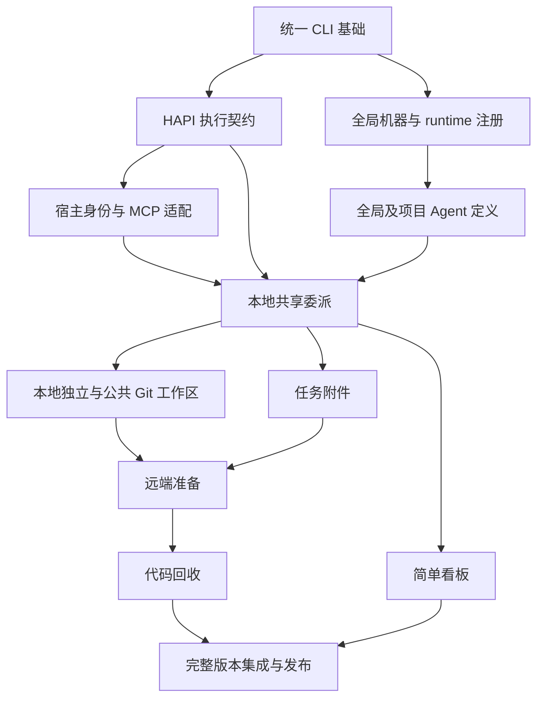
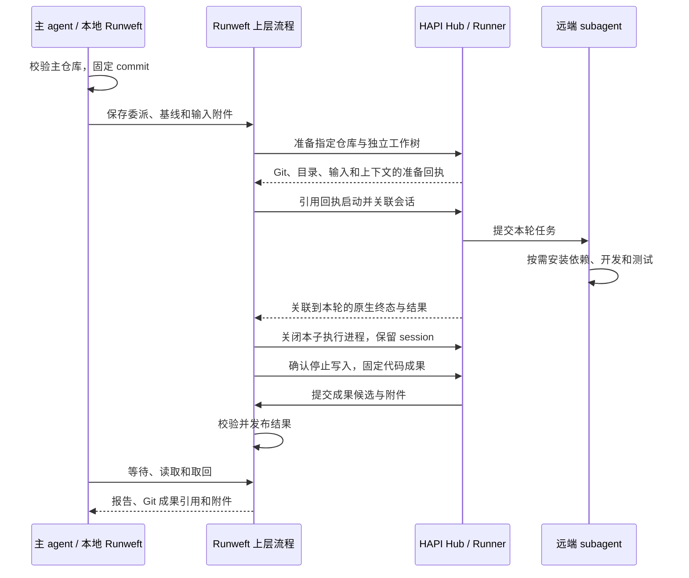

# 项目能力边界与讨论地图

> 更新：2026-10-01
> 本文保存产品决策、职责边界和 Change 依赖；原重构与Hub集中配置七阶段均已完成归档。当前实现事实以Specs为准。

2026-09-30 用户同意开始 [Hub空间、身份与集中Agent配置](archive/2026-10-01-hub-spaces-and-agent-configuration/requirement.md)：必须连接Hub后委派，Git仓库关联中心配置，独立身份token、空间与资源所有权；访客自行领取/保存token，不建设登录注册服务。[七阶段](archive/2026-10-01-hub-spaces-and-agent-configuration/delivery.md)已于2026-10-01完成：默认服务/CLI/MCP必连Hub，中心配置、独立用户/机器凭据和对象授权、完整后台/Skill及官网，1.1.0同候选四平台/源码/脱敏证据完整交付。真实十二组MCP、十组消费者、Playwright、安装升级清理与256项根测试通过，见[最终验收](archive/2026-10-01-hub-spaces-and-agent-configuration/acceptance.md)；Mac实机、物理跨机边界保留，未更新在线部署。

## 产品边界

只接入 Codex 与 Claude Code 主宿主，协作体验尽量对齐原生 Codex；执行目标与主客户端独立。Runweft 提供 MCP 和 HAPI 上层流程封装，何时使用什么 agent 由业务 skill 与主 agent 决定，不构建自动业务编排器。

执行侧直接复用 HAPI 已内置的 Codex/Claude Code 适配，不预设新增或主动改造其 launcher、原生协议、会话、审批与恢复。下文“执行契约”指已有能力的验证与调用封装；只有可复现缺口阻断既定行为时才评估最小增补。后续私有 runtime 接入不作为本轮交付前置。

**HAPI 已有能力优先复用。** 技术方案按“当前入口 → 是否足够 → 最小缺口”推导；已有会话、消息、状态、恢复、审批、文件与 UI 不重复实现。旧工程只参考交互和历史证据，不能完全照搬其 daemon、状态机、认证锁或补丁；具体边界见[执行基础需求](archive/2026-09-29-hapi-subagent-foundation/requirement.md#已确认的架构决策)。

Runweft 服务与 HAPI Hub 同机部署：HAPI 只监听私有 loopback，公开入口使用 Runweft 的身份/空间及 HAPI 对象授权网关。mode 只决定服务托管角色，hub.url 独立指定业务连接；本地自托管也须明确连接并完成身份与机器接入。机器、runtime、Agent 分别登记，不由启动服务自动创建。只补中心配置、授权和委派/交付关联，不复制 HAPI 原生会话库。当前行为见[部署](specs/deployment/spec.md)、[委派入口](specs/delegation/interface/spec.md)、[工作区模式](specs/local-workspace/mode/spec.md)、[附件](specs/artifacts/spec.md)和[远端成果](specs/remote-results/delivery/spec.md)。

## 完整版本的交付目标

2026-09-29 用户明确要求后续持续推进，交付完整、可安装运行的重构版本，不以 MVP、演示骨架或只有部分链路的版本结项。原十个领域 Change 的产品范围保留，另设全局资源注册和完整版本集成与发布两个 Change，共十二个；分阶段只用于控制依赖与验证，不降低最终交付范围。

完整交付须覆盖统一 CLI 一键辅助全局安装 MCP、清晰配置与持久数据布局、本地/Hub 两种运行模式、全局机器/runtime 注册、Codex/Claude Code 宿主 MCP、本地共享与独立工作区、远端准备与执行、等待/中断/续接、附件与代码取回、Agent 定义及全局 subagent 看板，并提供部署、诊断与维护说明。主 agent 负责代码接纳和冲突；产品自身不增加合并执行器。

原生详情、审批和默认执行权限继续复用 HAPI。Hub 后台负责独立身份、空间、机器/runtime、仓库、Agent 与任务的查看和管理；CLI 面向 Agent，产品 Skill 承担接入。集中 skill/MCP 管理、主宿主退出后的恢复和 runtime 插件平台不在范围内。

验收同时要求原生交互和安装部署证据，覆盖两种宿主、两种内置 runtime、本地/远端工作模式、任务续接、失败与交付重试。本地验收由 agent 自动完成；2026-09-30 用户明确允许 Playwright，并接手 Mac 实机验证，Mac 双架构仍须一并构建。物理远端验证按用户授权延期，同机多 Runner 的真实链路与物理跨机分别记录。源码、模拟测试和交叉构建不能代替对应实机证据，最终范围见[完整验收](archive/2026-09-30-integrated-release/acceptance.md)。

## 交付模块与依赖

原重构的拆分审查、六个阶段验收出口和唯一职责见 [Change 边界与分阶段交付](delivery-structure.md)。本次调整复用已有目录；下表为调整后的依赖，不再让本地执行依赖远端准备，或让宿主身份反向依赖委派。

| Change | 独立交付结果 | 前置 Change |
| --- | --- | --- |
| [统一 CLI 与部署（已完成）](archive/2026-09-29-unified-cli-and-deployment/requirement.md) | 可安装的基础入口、公共配置/数据位置、HAPI 管理与诊断 | 无；固定现有 HAPI 构建 |
| [HAPI 内置能力验证与调用封装（已完成）](archive/2026-09-29-hapi-subagent-foundation/requirement.md) | 验证并封装已有启动、输入、原生结果、停止与续接入口 | 统一 CLI |
| [宿主适配（已完成）](archive/2026-09-29-host-mcp-adapter/requirement.md) | 两宿主可信身份、受控子执行的 MCP 禁用与结果传递机制 | 统一 CLI、HAPI 执行契约 |
| [全局资源注册（已完成）](archive/2026-09-29-execution-resource-registry/requirement.md) | 分别注册机器和 runtime，查询真实可用性 | 统一 CLI |
| [Agent 定义（已完成）](archive/2026-09-29-agent-definition/requirement.md) | 可发现、校验及解析的全局/项目定义，引用 runtime | 统一 CLI、全局资源注册 |
| [委派生命周期（已完成）](archive/2026-09-29-delegation-lifecycle/requirement.md) | CLI/MCP 本地共享目录的完整协作与统一查询 | 统一 CLI、HAPI 执行契约、宿主适配、Agent 定义、全局资源注册 |
| [本地工作区执行（已完成）](archive/2026-09-29-local-workspace-execution/requirement.md) | 独立本地协作及公共 Git 准备/封存/保留能力 | HAPI 执行契约、委派生命周期 |
| [任务附件交付（已完成）](archive/2026-09-29-task-artifact-delivery/requirement.md) | 独立文件交付及既有任务的输入/输出接入 | 统一 CLI、委派生命周期 |
| [远端工作区准备（已完成）](archive/2026-09-30-remote-workspace-preparation/requirement.md) | 跨机基线与输入落地，复用公共工作区启动校验 | HAPI 执行契约、本地工作区、任务附件 |
| [远端代码回收（已完成）](archive/2026-09-30-remote-result-delivery/requirement.md) | 真实远端协作至主仓库取得成果的完整链路 | 远端准备、本地工作区、委派生命周期、任务附件 |
| [Subagent 看板（已完成）](archive/2026-09-30-subagent-dashboard/requirement.md) | 基于统一查询的全局概览，详情复用 HAPI | 委派生命周期、统一 CLI |
| [集成与发布（已完成）](archive/2026-09-30-integrated-release/requirement.md) | 全部能力组成同一可安装版本及完整实测证据 | 以上十一个领域 Change |

图省略传递依赖，完整直接前置以表格及各 Requirement 为准。前置表示实现与验收所需能力，不限制只读调查。全部 Change 已完成正式 Technical/Plan、各一次 iclaude 评审、实现与自动验收，并同步 Specs 归档；design.md 保留讨论过程。

## 本轮已经收敛的范围

- 本地模式可托管本机 Hub；任何委派都连接明确 Hub 并具备有效身份/空间，本地模式不提供离线配置退路。持久数据有统一根及路径诊断，不散落临时目录。
- 机器注册、runtime 注册和 Agent 定义分离：前两者为 Hub 全局资源，Agent 按空间及可选中心 Git 仓库定义，支持本人选择和空间成员共享。引用方向是 Agent → runtime → machine；HAPI flavor 不直接等于业务 Agent 定义。
- CLI 提供显式命令一键辅助全局安装、更新、诊断及卸载 Runweft MCP；开发验证使用专用配置，保留用户其他 MCP 与原生设置。

- 主宿主关闭后不要求恢复；在线主会话的查看、等待和续接按宿主适配实现。
- 远端只用独立 worktree；本地共享或独立由主 agent 决定。工作区分离不等于额外权限隔离。
- Agent 定义参考 Multica 的职责、指令与 runtime 分工；不集中管理 skill/MCP。启动 cwd 是主工作目录或准备完成的 worktree，沿原生规则加载项目配置。
- 只允许一层 Runweft 委派。HAPI 调度的 Runweft subagent 移除全部 Runweft MCP 工具，结果由 HAPI 原生输出收回；CLI 委派入口也拒绝受控子执行再次派生。原生内置 subagent 的使用和递归不由 Runweft 管控。
- 每轮任务结束关闭子执行进程，保留可续接的 session 和工作区；后续优先由 HAPI resume，确认 session 缺失才构造历史上下文。
- 冲突、合入与发布交给主 Agent；模型执行权限沿 HAPI/原生默认，不新增 OS 隔离。Hub 独立身份和对象授权保护配置及任务；资源后台在第六阶段实现。
- Runweft只支持当前数据格式，旧版/未知/损坏格式无写入拒绝，不迁移、兼容读取或清理旧数据，不提供data/reset。需要独立环境时使用新home；当前任务恢复及显式成果留存继续保留。

## 远端组合流程

这是跨 Change 的目标流程，独立 worktree 内程序化 checkpoint 与默认 bundle 交付已获用户确认。准备成功、执行结束、成果可取回和验收分别有自己的证据，不能合为一个完成标志。

## 共享对象的归属

这里只标记谁定义契约，不提前固定 API schema；下游引用上游定义，不各自造一份身份。

| 对象 | 定义归属 | 稳定范围 |
| --- | --- | --- |
| userId、spaceId、执行主体与业务 scope | Hub 身份/空间、HAPI 授权 | 用户/成员关系与真实对象；原生父身份由宿主适配提供，不另造本机 workspaceId |
| `hapiSessionId`、原生输入/轮次身份 | HAPI 执行契约 | 真实执行与恢复关联，不能假定恢复后 ID 永远不变 |
| machineId、runtimeId 与已解析执行目标 | 全局资源注册 | 当前用户/所选 Hub 的全局范围，项目定义只能引用；沿 HAPI 身份和查询映射 |
| 中心 Repository、Agent ID 与定义版本 | 仓库与中心 Agent | 真实 Git 观察关联仓库、本人选择与每轮不可变配置，独立于原生 Git environment ID |
| 宿主身份、主/子角色与 MCP 传递上下文 | 宿主适配 | 在委派之前识别，不由模型自报；业务工具由委派注册 |
| `delegationId`、`roundId` | 委派生命周期 | 关联已验证主工作区的父子上下文与每次明确任务输入；不由 prompt 自报路径代替真实 cwd 和机器身份 |
| `repositoryId`、`environmentId`、`preparationId`、固定 Git 成果 | 本地工作区执行 | 公共 Git 生命周期；远端准备消费，不重新定义身份或收尾 |
| `artifactId`、不可变对象与引用 | 任务附件交付 | 可授权读取的输入/输出及版本 |
| 任务/轮次的代码与附件清单 | 委派生命周期、代码回收与附件交付 | 沿 taskId/roundId 查询，不另要求 resultId；原生执行、封存、发布、取回和留存分别表达 |
| `requestId` | 各操作提供方 | 在主体与操作范围内去重；相同键不同内容拒绝，不能据此宣称跨服务原子事务 |

Runweft 只补必要协作与交付关联，原生会话/执行事实优先读取 HAPI，不复制成另一套会话库。CLI 和 MCP 复用同一上层流程，已有重试与消息去重沿 HAPI 实现。

## 技术验证结论

| 事项 | 当前证据 |
| --- | --- |
| 宿主身份与工具禁用 | 两宿主身份、Claude clear/resume、全局安装及 HAPI 子执行启动/续接的工具禁用已实测，见[宿主验收](archive/2026-09-29-host-mcp-adapter/execution.md#t4-配套构建与宿主整体验收)；原生子 agent 不管控 |
| 子进程关闭与 session 续接 | 两 runtime 已实测每轮停止和优先 resume，同一 delegation 保留原生记忆；定向关闭不影响共享 runtime 的兄弟会话 |
| 配置继承 | 最终原生组合已验证执行目录和工程指令/skill/其他 MCP；继承执行机器上的原生配置，远端不自动拥有发起机的全局 skill/MCP，ignored 项目配置不凭空随 Git 同步 |
| 通知与结果进入上下文 | 两宿主通过实际 MCP wait/read 响应取得报告，等待游标保留未读轮次完成；不声明原生后台唤醒，不增加主宿主退出恢复目标 |
| Git 成果方案 | 独立 worktree 自动 checkpoint、提交身份及 hooks/签名策略、固定 refs、bundle/LFS 传输与显式取回已验收；共享主目录不自动提交，见[Git 生命周期](specs/git-workspace/lifecycle/spec.md) |

各领域 Research 保存 HAPI 复用点和已复现的缺口，Technical 记录最小补充，不迁回旧实现框架。最终组合证据与限制见[发行验收范围](specs/release/acceptance/spec.md)。

## 原重构实施结果（2026-09-30）

2026-09-30 完成十二个 Change；原先的跨模块技术缺口均按契约归属落实，发行验收没有接收尚未完成的领域功能。

| 能力 | 已落实结果 |
| --- | --- |
| 协作逻辑的部署与存储 | serve 内中心协调已运行，schema v6 保存资源、任务/轮次、请求、文件清单、基线/导入/消费者/诊断及代码清单/取回记录；HAPI 保存中心字节和机器传输。重复接受、文件恢复及重启查询已验证 |
| HAPI 原生执行契约 | 两种内置 runtime 的输入关联、原生结果、请求重查、定向中断、审批、停止与续接已通过真实验收；共享进程兄弟会话可继续执行，已证实缺口在 HAPI 原路径最小增补 |
| 宿主身份与结果交互 | 身份、安装、工具禁用及真实派生/等待/续接/控制已通过两宿主 × 两 runtime、local/同机 Hub 验收；支持工具响应，不声明后台唤醒 |
| 工作区与交付一致性 | 本机 shared/worktree、LFS/子模块、启动前输入、停止后 Git/文件收尾、续接及留存清理已验收；远端固定基线、独立环境、原生准备门禁和显式释放已验收；Git bundle/LFS/递归未变模块成果交付、主仓库取回及显式留存释放已验收 |
| 发行与运行维护 | 1.0.0 四平台包与校验清单、Linux x64 独立安装/原生组合、schema v6 升级回退和备份恢复通过；公开发布未执行，见[发行产物](specs/release/distribution/spec.md) |
| 真实验收条件 | 专用配置副本完成两宿主/两 runtime 自动验收及 Playwright；Mac 实机用户负责，Linux arm64 为 QEMU CLI/配置，物理远端延期，具体环境限制在验收中逐项保留 |

2026-09-29 用户明确确认以下两项默认策略；轮次结束保留 worktree 的既有决策继续有效：

| 决策 | 已确认默认行为 | 影响 |
| --- | --- | --- |
| 遗留代码如何形成成果 | 仅在 subagent 独立 worktree 内补 checkpoint，保留 agent 已有提交；共享主目录不自动提交，提交失败保留现场 | 遗留改动由程序封存，无改动不产生空提交 |
| 未 push 的提交如何传输 | 输入基线与输出成果通过 Git bundle 传输，允许无 remote 或尚未 push 的提交；未提交的主工作区文件不自动传入 | 远端任务与成果取回不依赖 Git 托管平台；push/PR 仍由主 agent 按业务需要处理 |

原完整重构沿[六阶段交付结构](delivery-structure.md#阶段与可验收结果)逐项完成，领域功能先独立验收，再以同一已安装候选完成组合。当时的全局看板使用旧认证；当前默认入口已切换为Hub身份，旧/runweft页面不再开放。远端委派与结果回收已接中心配置，完整资源和任务页面及Skill已在Hub第六阶段交付，第七阶段完成1.1.0整体发行。下列2026-09-30调查证据保留历史范围，不替代新版候选验收。

## 调查与验证状态

- HAPI/Multica 的源码与文档证据按主题保留在[执行基础调查](archive/2026-09-29-hapi-subagent-foundation/research.md)、[远端准备调查](archive/2026-09-30-remote-workspace-preparation/research.md)和[代码传输实验](archive/2026-09-30-remote-result-delivery/research.md)。
- 早期 macOS/Linux arm64/x64 基础安装证据见[部署执行记录](archive/2026-09-29-unified-cli-and-deployment/execution.md)与[调查](archive/2026-09-29-unified-cli-and-deployment/research.md)。最终版本新增 Linux x64 安装、20 组核心协作、8 组附件和 2 组 MCP 控制，远端使用同机独立 Hub/两个 Runner；早期证据不代替最终 Mac 实机运行。
- 最终原生历史重建、审批/中断、备份升级回退及 Playwright 均通过；Mac 与物理跨机缺口沿用户决定保留，详见[完整交付验收](archive/2026-09-30-integrated-release/acceptance.md)。
- 历史宿主调查使用 Claude Code `2.1.269`；正式宿主 MCP 验收使用 Codex `0.156.1`、iclaude/Claude Code `2.1.283`，覆盖专用 local/hub 连接、真实安装调用、clear/resume 和子工具禁用，见[宿主执行记录](archive/2026-09-29-host-mcp-adapter/execution.md)。评审进程与执行验收分开记录。
