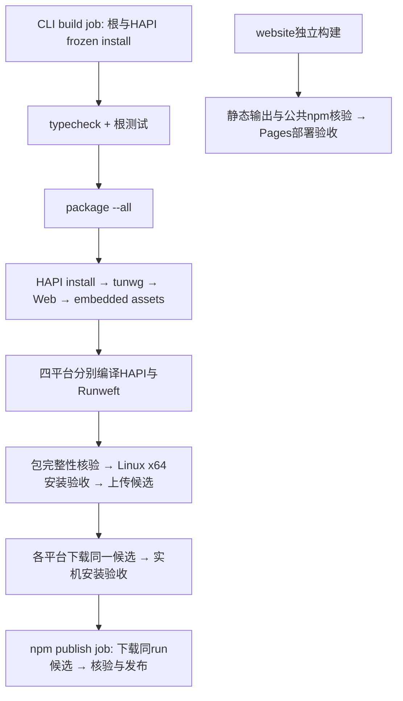

# 构建发行审查（U02）

主agent核对当前`.github/workflows/cli-install.yml`、`npm-publish.yml`、`website-pages.yml`和`scripts/build-hapi.ts`、`package.ts`。以下是源码调用图，不是远端CI执行结果。

同一build job确有两次HAPI frozen install；Web在平台循环外，只构建一次。独立build-hapi调用、每个平台安装、包冻结身份校验、发布与官网验证是不同边界。本轮不改workflow、不删独立package校验，也不引入跨run缓存。npm的candidate job复用CLI installation workflow，publish不再次编译；其他触发产生的独立run不在本次去重范围。

已落地的S08仅为根测试内三次同源码CLI编译改为本进程一次只读产物。实际编译计数、单文件独跑、编译失败传播、清理故障及目录回收结果见execution的T12和本地t12-lifecycle-summary.json。
