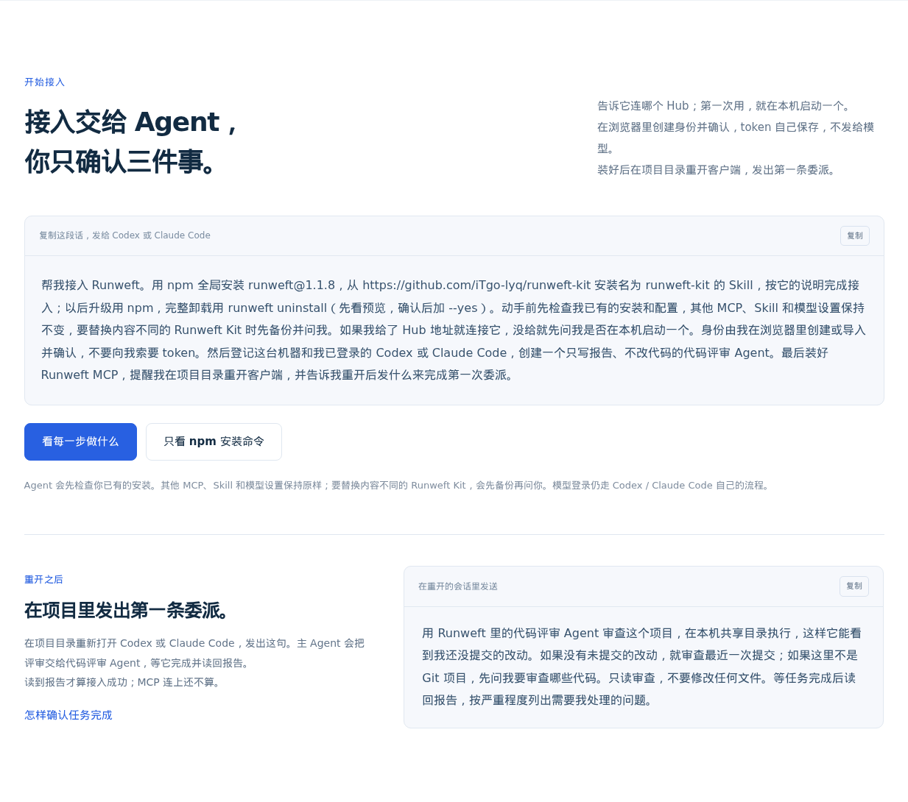
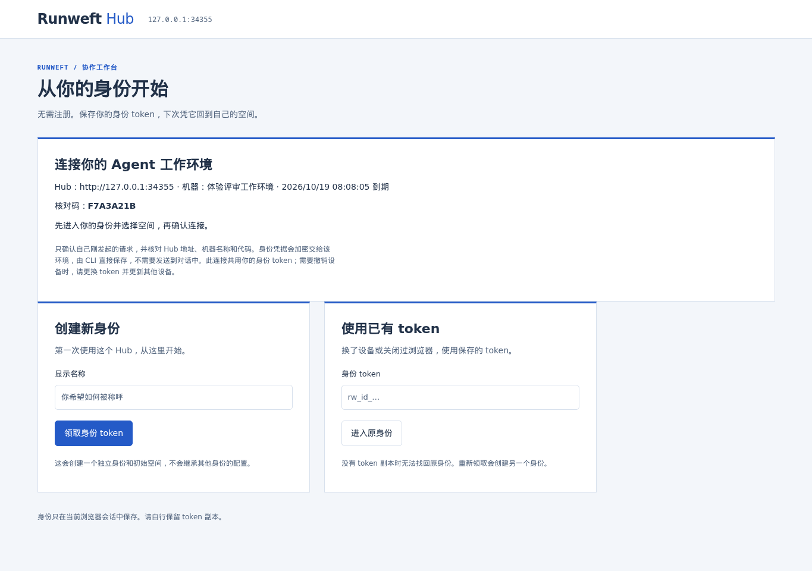
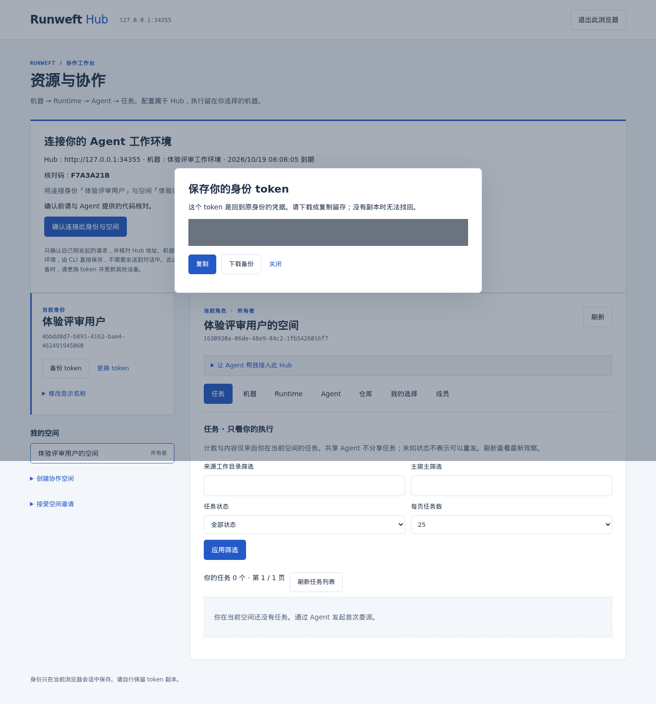
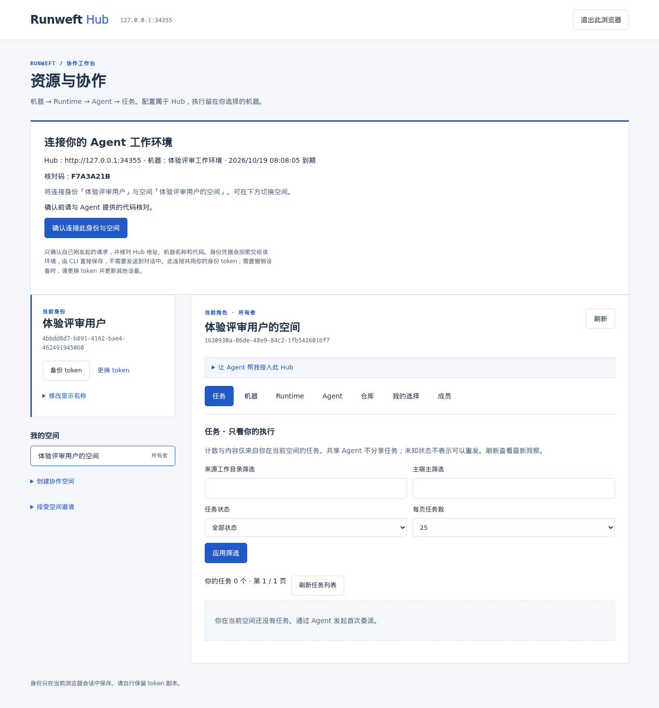
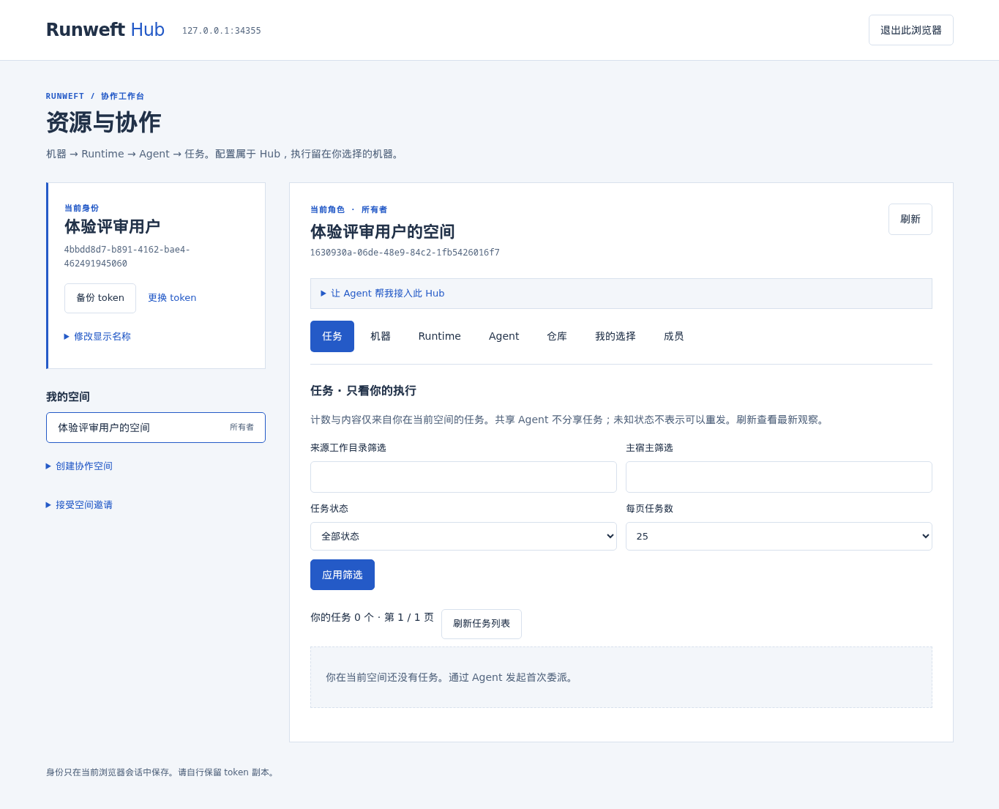
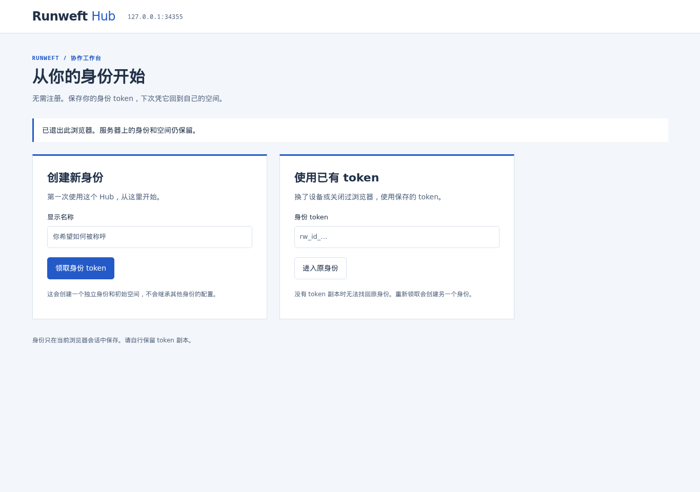

# 首次体验审查与目标流程

用户希望减少首次体验中的人工交互，让 Agent 通过 CLI 完成能自动执行的工作。本次从官网入口、浏览器身份创建、连接确认、返回工作台到退出重登，实际走了一遍当前产品。目标流程与 [账号密码方案](technical.md) 一起实施。

## 本轮证据范围

2026-10-19，使用基线 `bc18a394812360d329090dfcb46137234a4f76e0` 的源码 Hub、Bun 1.4.2、已按项目机制核对 pin/源码状态/程序摘要的配套 HAPI，以及 Playwright Chromium。官网为填充当前 1.1.8 版本的本地构建；浏览器视口 1365×960，部分截图为全页。

专用临时数据目录与随机 loopback 端口下，实际完成了创建身份、默认空间、浏览器连接确认、CLI complete 返回 connected、退出回到入口；页面异常数为 0。六张截图均逐张查看，token 正文在截图时遮罩。结束后专用 Hub、网站和浏览器关闭，状态确认服务与 Runner 未运行，临时运行数据已删除。

未执行真实安装、真实模型、真实机器/Runtime 接入、线上官网、移动端或完整无障碍验收。因此下文把截图观察、代码可行性和新方案建议明确区分。

## 当前步骤与发现

### 1. 官网接入：已有 Agent 入口，但首次结果被放在第二轮请求之后

可复制的接入提示让用户无需逐条输入 CLI，这是应保留的入口。当前提示要求用户理解 Hub、保存身份 token、重开客户端，再复制第二段话发起首个任务；首份有用结果到来前存在多次页面/会话切换。

改造：官网只提供一段包含安装与首次只读任务授权的体验指令。完整手动命令放入工程参考。MCP 重载按宿主实际要求提示，不作为 CLI 首份结果的前置。

### 2. 匿名连接页：核对信息完整，用户目标被技术概念遮蔽

Hub、设备名和核对码清晰，保留这些信息能让用户判断是否为自己刚发起的连接。大段身份、空间、token 说明占据主区域，“领取身份 token”要求普通用户先理解凭据模型。

改造：以“连接你的工作环境”为页面目的，默认显示账号密码注册/登录。连接摘要保持可见，原理说明折叠；仅多个空间且没有有效默认值时增加一次选择。

### 3. 创建后的 token 备份弹窗：最高优先级断点

用户刚提交名称，就被要求复制/下载并决定存储位置，且被告知丢失无法找回。此次实际直接关闭弹窗也能继续，说明页面既增加了操作，又不能保证用户完成备份。

改造：账号密码替代人工保管 token。页面不出现身份 token 的复制、下载、备份或导入；密码管理器可以辅助保存普通账号密码。

### 4. 再次确认连接：明确授权应保留，提交可以合并

当前用户须先创建身份、处理备份弹窗，再点击确认连接。仅有一个初始空间时已自动选中，这是现状已有的合理默认，不能误报成必须手选空间。

改造：最终按钮直接写“注册并连接”或“登录并连接”，提交前展示设备、Hub、核对码及授权效果。用户的一个明确动作同时表达登录/注册与授予该环境访问的意图；后台仍区分两者的成功和失败，不能把普通注册当作隐式设备授权。

### 5. 连接后空工作台：页面未清楚交代下一步

实际 CLI 已返回 connected；页面展示身份/空间 UUID、资源导航和空任务筛选器。用户很难从空表判断刚完成的只是连接，以及接下来应该回到哪里。机器、Runtime 和 Agent 此时尚未准备。

改造：从连接流程进入时优先显示“已授权，可以返回对话；Agent 会继续完成接入”。页面只说明浏览器授权事实，本机连接和执行准备结果由 CLI 在完成远端校验与本地保存后报告；不要求用户复制状态或回复“已经点好”。一般工作台仍可访问，首次空态只给出一个明确的继续方向。

### 6. 退出后重登：正常返回依赖找到外部 token 副本

返回页仍并列突出“创建新身份”和“使用已有 token”。正常用户需要寻找此前的备份，丢失后只能创建另一身份。账号密码应成为返回默认入口，注册为次级入口，忘记密码明确指向部署者协助重置。

## 新目标路径

常规首次场景假定：用户在希望评审的源码目录使用已登录的 Codex 或 Claude Code，采用含安装与首次任务授权的接入指令，无未知安装冲突、无额外原生审批。以下是目标，尚未实现或计时验证。

| 顺序 | 用户看到或操作 | Agent 自动完成 |
| --- | --- | --- |
| 1 | 发送一次“帮我接入并完成只读体验” | 检查已有状态，安装缺失程序/Skill/MCP；决定已指定、已连接或默认本机 Hub |
| 2 | 打开一个连接链接 | 创建或恢复同一连接请求，展示设备和核对码，有界等待 |
| 3 | 在一张表单输入账号密码，点“注册并连接” | 自动创建默认名称/空间；浏览器授权后 CLI 完成保存与远端校验 |
| 4 | 返回原对话，无需再发送确认文本 | 登记/复用机器、关联空间、启动 Runner、登记/复用当前执行工具、关联当前Git项目和私有评审 Agent |
| 5 | 直接读到首份报告 | 使用 task CLI 发起、等待并完整读取只读任务结果 |
| 6 | 仅宿主需要时重开客户端 | MCP配置与实际可用性单独报告；后续原生会话完成MCP验证 |

常规路径的目标是**一次接入请求、一张账号与连接表单、零条用户手工 CLI、无需第二段体验提示**。打开链接和返回对话仍是实际动作；不把它们包装成“零交互”。模型工具未登录、原生审批或任务目录缺失属于明确异常，不承诺替用户处理。

已有账号从 Agent 链接新开标签时，通常仍需“登录并连接”，可用密码管理器自动填充；只有连接页所在标签已有有效登录时才仅确认，不能沿用另一个标签的会话。已有有效 CLI 连接时跳过浏览器。默认显示名称取用户名，默认空间使用新建初始空间，机器名取当前主机展示名，执行工具取当前宿主类型，模型参数继承执行端默认。首个私有 Agent 可由 Skill 使用固定只读用途创建，不要求用户填写内部字段。

## 能用 CLI 的步骤及保留的人工作用

| 事项 | 责任与规则 |
| --- | --- |
| 安装、版本、配置、健康检查 | Agent 通过CLI检查和执行；复用原状态，不要求用户截图或抄结果 |
| Hub目标 | 明确地址优先，既有连接其次；无两者时默认体验指令已授权本机启动；已有目标变更再询问 |
| 原生工具选择 | 从当前宿主和已安装工具判断；信息冲突或不可用时一次说明必要选择 |
| 密码与模型登录 | 用户在各自安全界面输入；Agent不代填、不索要、不读取原生凭据 |
| CLI授权 | 用户核对环境并明确确认；Agent轮询同一请求，不让用户复制token或复述结果 |
| 机器/Runtime/Agent | Agent用返回的UUID管理，优先复用；不按同名猜测，不自动共享执行能力 |
| 仓库关联 | Git项目仍需匹配/绑定，由Agent用inspect/match及必要的create/bind完成；有歧义才问，不绕过现有授权 |
| worktree/模型设置 | 首次本机shared只读体验不要求用户先配置worktree或选模型，执行端沿用默认 |
| 首次任务 | 接入指令已授权时Agent直接用CLI完成；只安装的请求不自动变成模型调用 |
| 异常与重试 | 原请求查询和定向恢复；不重建账号、不替换身份、不盲目重发任务 |
| MCP加载 | 能即时使用就核对；需要重载才提示一次，不假装CLI结果验证了MCP |
| 托管环境或模型审批 | 保留真实平台要求；不靠额外权限模式或绕过审批减少交互 |

## 接入提示建议

下面是后续官网/Skill的拟议用户指令，不是本轮要在开发者环境执行的操作：

> 帮我接入 Runweft，并在当前项目完成一次只读代码评审。先复用已有安装和连接；我给了 Hub 地址就连接它，没有现有连接和指定地址时就在本机启动。使用我当前客户端已登录的执行工具，安装需要的 Runweft Skill 和 MCP，完成机器、工具和评审 Agent 配置。账号密码由我在浏览器填写，你给我一个注册或登录并确认连接的链接。确认后自动继续，用 CLI 发起任务、等它完成并读回报告。只有确实缺少选择、发生安装冲突或需要原生登录/审批时再问我；不要修改其他 MCP、Skill 或模型设置。

用户不需要知道每条底层命令；Skill维护实际操作次序、现有对象复用、同请求恢复和成果验证。减少交互靠明确默认值和Agent执行，不能靠隐藏副作用或抹掉真实授权边界。

## 可访问性与验证限制

截图可见字段标签、文字按钮、状态提示和卡片层级，当前流程可通过DOM定位完成。认知负担主要来自长凭据管理、大段技术概念以及空工作台方向不清。本轮未执行完整键盘遍历、读屏、颜色对比、缩放或移动端检查，不能据此声称无障碍合规。

新页面须验收密码管理器自动填充、允许粘贴、密码显示按钮名称、错误与字段关联、提交中防重复、焦点恢复、键盘操作、窄屏和状态播报。新的最少交互路径由 Playwright验证表单/步骤，再由独立 Agent 场景验证CLI自动推进；真实首份模型报告与MCP实际调用保留各自验收证据。
